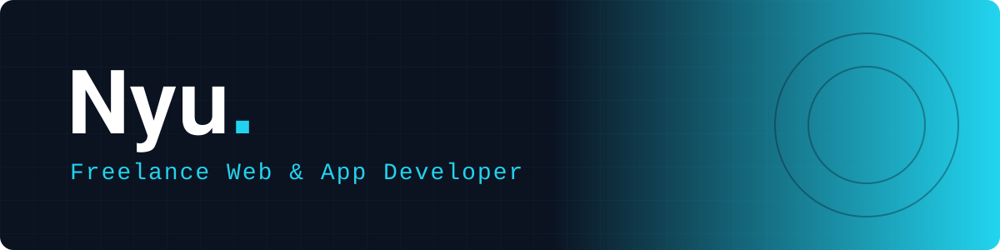

  

---

## 👋 About

Hi, I'm **Nyu** (Banyu), a freelance web & app developer.
I build clean, fast websites and apps for individuals, small businesses, and clinics.
My portfolio is available in **Indonesian and English**, with dark/light mode.
Have an idea or a problem to solve? [Let's talk](mailto:valentinobanyu0@gmail.com).

## 🛠️ What I can build for you

| | |
|---|---|
| **Landing pages & company profile websites** | Clear, fast pages that present your business well |
| **Web apps & dashboards** | Custom tools to manage your data and daily work |
| **Monitoring systems** | Dashboards to keep track of things that matter |
| **Mobile apps (Android)** | Native Android apps built with Kotlin |

## ⚡ Tech stack

**Frontend** 

**Backend** 

Also building offline-first apps

**Mobile** 

**Design** 

**Also** 

**AI tools I use while working** 

## 🚀 Featured project

**[My portfolio website](https://portfolio-website-trfupfoq.edgeone.dev)**
Built with Next.js, TypeScript, and Tailwind CSS. Bilingual (Indonesian / English), accessible, with dark and light mode.

<!-- TODO: add a screenshot, e.g.  -->

[**View it live →**](https://portfolio-website-trfupfoq.edgeone.dev)

## 🔭 Currently exploring

Computer vision, reinforcement learning, and cybersecurity.

## 📬 Contact

GitHub stats (optional)

 

If the card does not load, it is a third-party service issue; remove this block.

